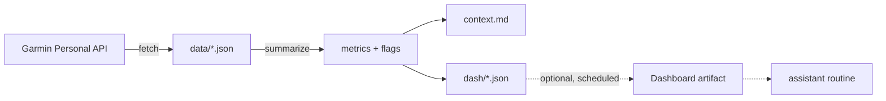

# garmin-training-context

Turns your Garmin data into a short training-context summary: weekly load, recovery figures and four warning flags, as a Markdown file and four JSON datasets. Made for feeding an AI assistant or a dashboard, built for my own workflow and shared as a reference.

[](https://github.com/reian-dhr/garmin-training-context/actions/workflows/ci.yml)


## What it does

I wanted an assistant to know whether today suits a hard or an easy session without me opening three apps. This pulls 90 days of activities, daily summaries, HRV, sleep and Body Battery from Garmin's official Personal API, works out the numbers in code (not by asking a model to eyeball them), and writes a summary an assistant can read. GPS and profile fields are never copied into the outputs.



## See it without a key

Needs Python 3.12 or newer.

```bash
uv venv --python 3.12 .venv
uv pip install --python .venv/bin/python -e .
.venv/bin/python -m garmin_context demo
```

This builds from synthetic data and writes `demo_output/`. A finished copy is in [`examples/sample_output/`](examples/sample_output/), including a load-spike flag and an HRV flag. Nothing there is real data.

## Quick start

You need Python 3.12 and [uv](https://docs.astral.sh/uv/) (or pip), plus a Garmin Personal API key (next section).

```bash
uv venv --python 3.12 .venv
uv pip install --python .venv/bin/python -e .
cp .env.example .env.local            # paste your key after GARMIN_PERSONAL_API_KEY=
cp config.example.toml config.toml    # optional
.venv/bin/python -m garmin_context fetch
.venv/bin/python -m garmin_context build
```

Check it worked: `fetch` prints a record count per dataset, `build` prints the flag count, and `context.md` holds the summary. Tests need no key or network (the retry tests log "retrying" lines; that is expected):

```bash
.venv/bin/python -m unittest discover -s tests
```

## Getting a Garmin Personal API key

Per [Garmin's Personal API page](https://developer.garmin.com/gc-developer-program/personal/personal-api), anyone with a Garmin Connect account can create one. As of 31 Oct 2026:

1. Log in to Garmin Connect on the web and open the Personal API Key page.
2. Select **Create Key**, accept the terms and choose an expiration period (30, 90, 180 days or one year).
3. Select **Create**. The key is shown once, so copy it somewhere safe. If you lose it, delete it and create a new one.

Garmin sends a reminder email about a week before it expires. The key is not used directly: each run exchanges it for an access token. More in Garmin's [developer documentation](https://developer.garmin.com/gc-developer-program/personal/personal-api) and on [github.com/garmin](https://github.com/garmin).

## Configuration

Optional `config.toml` in the folder you run from. Without it the defaults apply.

| Option | Default | Description |
|---|---|---|
| `timezone` | `UTC` | IANA name, for example `Europe/Paris`. Sets "today" and the Monday-to-Sunday weeks. |
| `gym_target` | `3` | Strength sessions per week, shown against the actual count. |
| `[sports]` | built-in table | Garmin activity type to category overrides. Unknown types count as `other` with one warning. See [docs/sports.md](docs/sports.md). |

The key comes from `GARMIN_PERSONAL_API_KEY`, as an environment variable or in `.env.local`.

## How it works

Load is Garmin's own per-activity training load, summed per week. The summary compares this week and last week with the 4-week average and reports recovery (HRV, sleep, resting heart rate, Body Battery). Four flags: load spike (last 7 days over 1.3 times the 4-week average), HRV below baseline for 3 nights, resting heart rate 5 bpm above its 28-day mean, sleep score under 60 for 2 nights. Definitions are in [docs/metrics.md](docs/metrics.md); the thresholds are my rules of thumb, not medical advice.

## Scheduled run and dashboard (optional)

The core above runs anywhere. The way I use it is a scheduled claude.ai cloud routine that runs `fetch` and `build` twice a day and uploads `dash/*.json` to a Dashboard artifact, which a second assistant routine reads. That part relies on claude.ai routines and Dashboard artifacts, which are research-preview features, and it needs the key stored as a variable in the routine's cloud environment. The prompt template is [`examples/garmin_sync_prompt.template.md`](examples/garmin_sync_prompt.template.md) and the dashboard page is [`examples/dashboard_page.html`](examples/dashboard_page.html).

## Troubleshooting

| Message | Fix |
|---|---|
| `GARMIN_PERSONAL_API_KEY not set` | Put the key in `.env.local` or the environment variable. |
| `Garmin rejected the API key or token (HTTP 401 or 403)` | The key expired, was deleted or was copied wrongly. Create a new one. |
| `Could not get an access token` | Same causes; the key is checked when it is exchanged for a token. |
| `Garmin API still failing after 4 attempts` | Network errors and HTTP 429, 500, 502, 503, 504 are retried with 2, 4 and 8 second waits. Try again later. |
| `Warning: no activities in the last 90 days` | Sync your watch to Garmin Connect, then rerun. |
| `Unknown activity type ... counted as 'other'` | Add the type under `[sports]` in `config.toml`. |
| `config.toml: timezone ... is not an IANA time zone name` | Use a name like `Europe/Paris`. |

## FAQ

**Can I use it for someone else's account?** No. The Personal API is for your own Garmin Connect data. An app serving other users needs a different Garmin program.

**Does my data leave my machine?** Run locally, the only network traffic is to Garmin's API. The raw answers go to `data/`, and the Garmin client caches the 24-hour access token in `~/.config/garmin`. In the scheduled setup the fetch runs in a claude.ai cloud session, and the derived datasets (no GPS, no profile fields) go to a Dashboard artifact in your claude.ai account.

**Why not an MCP server?** Several Garmin MCP servers already exist for querying Garmin data from an assistant. This repo does something narrower: it computes a training-context layer in code.

## Status and limits

- The Garmin client is pinned to 1.0.0, the only release on PyPI when I checked.
- Retry covers network errors and temporary server errors. Garmin's rate limits are not documented here and Retry-After is not read, because the client does not expose response headers.
- Distance is shown for running and hiking and walking only.
- The scheduled part depends on research-preview claude.ai features.

## License

MIT, see [LICENSE](LICENSE).
